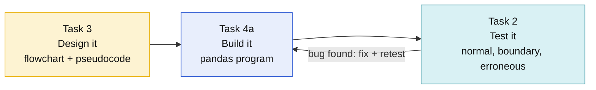

# T Level Digital Software Development: ESP Cheat Sheets


Visual, high-mark revision sheets for the Employer Set Project. Each sheet shows the idea as a **diagram first**, then the exact wording, code and checklist you need to hit the top band.

## The tasks at a glance

| Task | Sheet | Marks | What earns the marks |
|------|-------|:-----:|----------------------|
| **2** Testing and fixing code | [task-2-testing-and-fixing.md](task-2-testing-and-fixing.md) | 21 | Quality of tests (9), understanding (3), the fix (9) |
| **3** Designing a solution | [task-3-pseudocode.md](task-3-pseudocode.md) | 18 | Decomposition (9), logic and conventions (6), communication (3) |
| **4a** Coding with pandas | [task-4a-pandas.md](task-4a-pandas.md) | 34 | Organisation (8), user experience (8), functionality (6), security (6), logic (3), robustness (3) |

## How the tasks connect

The same program idea runs through the project. Names you choose in the design should appear unchanged in your code and your tests.



## Ten rules that pick up marks across every task

| # | Rule | Where it matters |
|:-:|------|------------------|
| 1 | Write the **expected result before** you run anything | Task 2 |
| 2 | Test **one below, on, and one above** every limit | Task 2 |
| 3 | Every fix gets a **retest** | Task 2 |
| 4 | Split the problem into **inputs, processes, outputs** | Task 3 |
| 5 | Use the **same function names** in flowchart, pseudocode and code | Tasks 3, 4a |
| 6 | Label **both** arrows (Yes / No) on every decision | Task 3 |
| 7 | Decide "no results" **after** the loop, never inside it | Tasks 3, 4a |
| 8 | **Validate every input** and never index a list with an unchecked number | Task 4a |
| 9 | Processing functions **return**; report functions **print** | Task 4a |
| 10 | The user never sees a **traceback** | Tasks 2, 4a |

## Repo layout

```text
esp-cheat-sheets/
├── README.md
├── requirements.txt
├── .gitignore
├── task-2-testing-and-fixing.md
├── task-3-pseudocode.md
├── task-4a-pandas.md
└── examples/
    ├── task2_boundary_tests.py   # runnable boundary tests
    ├── task4a_program.py         # complete menu-driven pandas program
    └── results.csv               # sample data for the 4a program
```

## Run the examples

```bash
pip install -r requirements.txt
cd examples
python task2_boundary_tests.py   # every line should say PASS
python task4a_program.py         # menu-driven results explorer
```

> [!TIP]
> Open the sheets on GitHub (or any viewer that renders Mermaid) to see the diagrams. In a plain text editor they show as code blocks.
