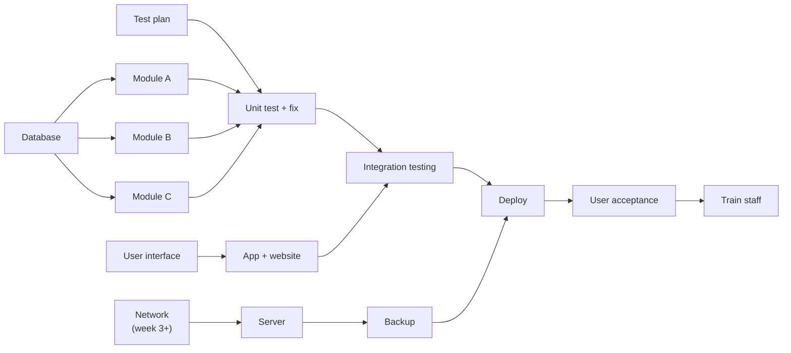
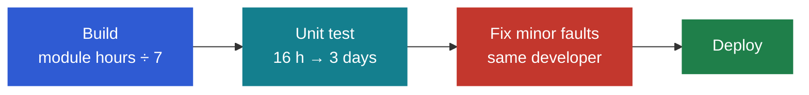
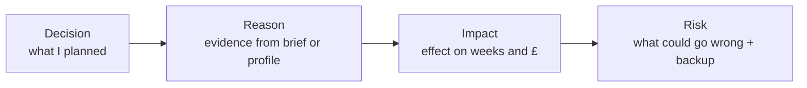

# Task 1 · Planning a project

**18 marks:** Gantt 3 · Costs 3 · Staff allocation 3 · **Rationale 9**

## 1. Map dependencies before the Gantt

- The database starts on **day 1**: almost everything reads from it.
- Developers can work on their own machines while the network engineer is away.
- Hardware waits for the right person. Nothing is deployed before the server.

## 2. Every module is a sprint

- The **same developer** fixes their module's minor faults straight after unit testing.
- Run several sprints **side by side**.
- Put **two people with different skills** on major faults.
- Aim for about **3 weeks over** the client's target, and say why.

## 3. Hours → days

| Hours | ÷ 7 | Plan |
|---|---|---|
| 92 | 13.1 | **14 days** |
| 85 | 12.1 | **13 days** |
| 16 | 2.3 | **3 days** |

Always round **up**. The spare time is your contingency: say so in the rationale.

## 4. The 3-year profit model

| Row | Year 1 | Year 2 | Year 3 |
|---|---|---|---|
| Income | current | × first rise | × second rise |
| Current running costs | ✓ | ✓ | ✓ |
| One-off costs (hardware, fees, licences) | ✓ | – | – |
| Project staff + project manager pay | ✓ | – | – |
| New ongoing costs (hosting, maintenance) | ✓ | ✓ | ✓ |
| **Profit** | income − costs | income − costs | income − costs |
| **Running total** | = profit | + year 2 | + year 3 |

Use formulas (`=SUMIF`, cell references), never typed-in totals.

## 5. Allocating staff

| Person type | Give them |
|---|---|
| Senior developer (expensive) | Hardest module, reviews, major faults |
| Junior developer | UI or app, with senior review |
| Database specialist | Database first, then a second module |
| Network engineer | All hardware, in order: network → server → backup |
| New starter | Their own module, with a check-in |

Check that every Gantt row has a name, and nobody is idle for weeks.

## 6. Rationale paragraph (9 marks)

> "I scheduled the database first **(decision)** because three modules read from it **(reason)**. Starting on day 1 lets those modules begin in week 3, saving about two weeks **(impact)**. Abdul is new, so Morgana reviews his design at the end of week 1 **(risk)**."

Cover all of these:

- [ ] Is the deadline realistic? Say so early.
- [ ] Why tasks are in this order
- [ ] Who does what, and why
- [ ] Risks: absence, inexperience, dependencies
- [ ] Where the contingency is
- [ ] Backup choice: reliability and security, not just price

## Never

- ❌ All fault fixing at the end, on one person
- ❌ Hardware before the network engineer is back
- ❌ UAT before deploying
- ❌ Staff pay charged in years 2 and 3
