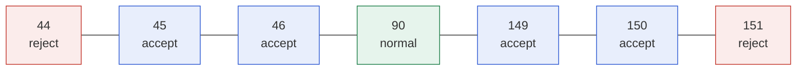
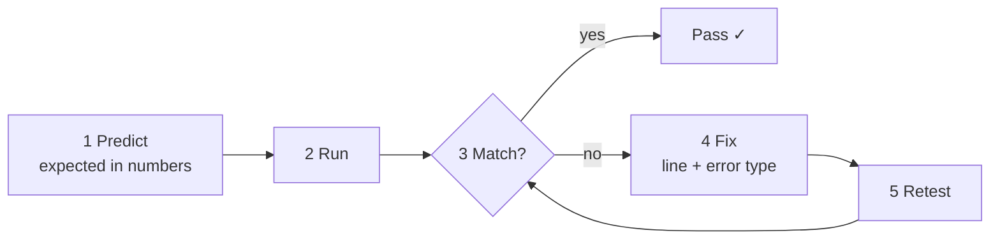

# Task 2 · Testing and fixing code

**21 marks:** Use of testing 9 · Understanding of testing 3 · The solution 9

The difference between band 2 and band 3 is the **quality of your tests**, not how many bugs you find.

## 1. Three kinds of test data

Example: valid weights are 45 to 150 kg inclusive.

| Type | Example | Purpose |
|---|---|---|
| Normal | 90 | Typical valid value |
| **Boundary** | **44, 45, 46, 149, 150, 151** | One below, on, and one above **each** limit |
| Erroneous | `"abc"`, blank, −5, 1.5 | Wrong type or nonsense |

## 2. Three kinds of error

| Type | What happens | Example |
|---|---|---|
| Syntax | Won't start; Python points at the line | Missing `:` or `)` |
| Runtime | Starts, then crashes with a traceback | `NameError`, `TypeError` (`"3" * 2.5`) |
| Logic | Runs, but the answer is wrong | `>=` instead of `>`, 5% instead of 0.5% |

Logic errors are only caught by a prediction you wrote **before** running.

## 3. The loop for every test

## 4. Test log: six columns, every row

| Test | Data (type) | Expected | Actual | Line · error type | Fix · retest |
|---|---|---|---|---|---|
| Upper weight limit | 150 (boundary) | Accepted | "Not a valid weight" | Line 40 · logic | `>=` → `>`. Retested 149, 150, 151: only 151 rejected ✓ |
| Weeks as a decimal | 1.5 (normal) | Accepted, 1 dp output | "Not a number" | Line 18 · logic | `isdigit()` → `float()` in try/except. Retested 1.5, 2, "abc" ✓ |

## 5. Work out expected values by hand

Example: 80 kg → 76 kg in 2 weeks, not injured (max 1% a week)

| Step | Working | Value |
|---|---|---|
| Weight to lose | 80 − 76 | 4.0 kg |
| Needed per week | 4 ÷ 2 | 2.0 kg |
| Recommended max | 80 × 0.01 | 0.8 kg |
| Allowed? | 2.0 > 0.8 | **No** |

## Never

- ❌ "Works as intended" when the output is wrong (e.g. −10 kg)
- ❌ Screenshots as the expected result
- ❌ A fix with no retest
- ❌ Debug `print`s left in the final code

Practise with `practice/bug_hunt.py`.
