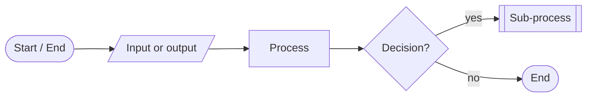
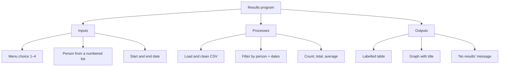
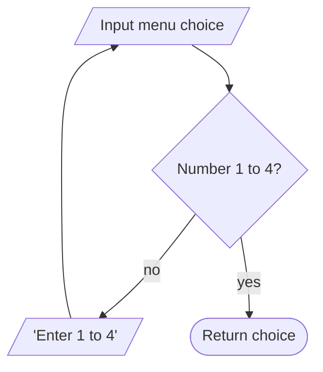
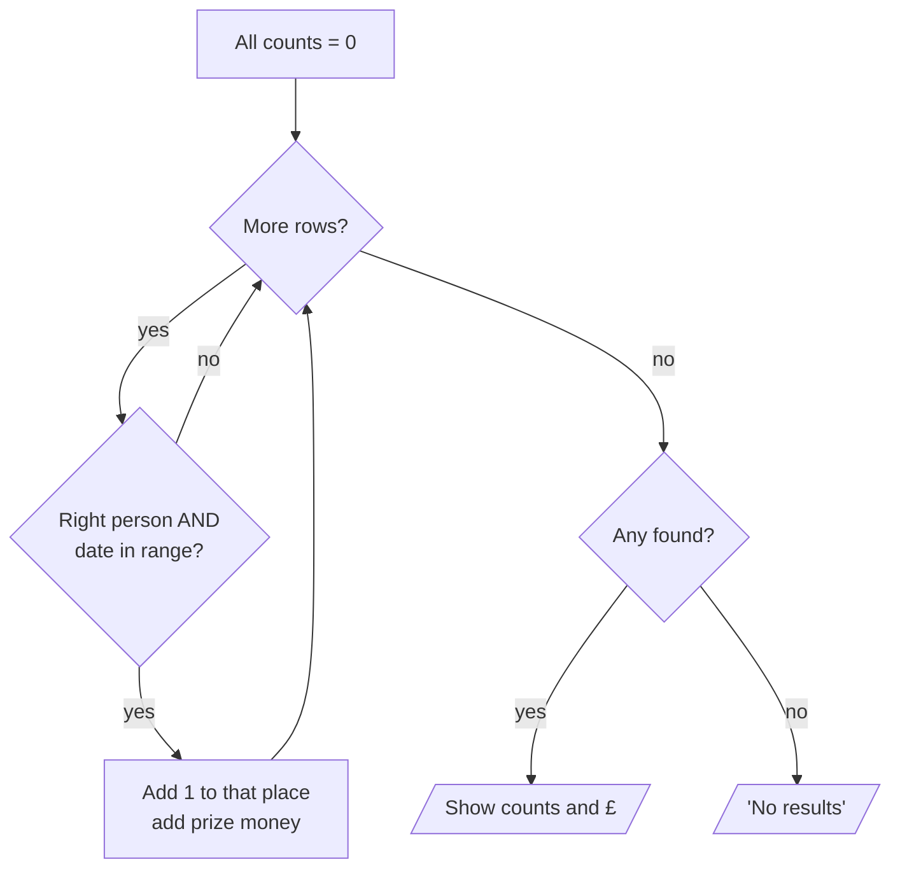

# Task 3 · Designing a solution

**18 marks:** Decomposition 9 · Logic and conventions 6 · Communication 3

## 1. The five shapes



| Shape | Use for |
|---|---|
| Rounded (terminator) | Start and End, once each |
| **Parallelogram** | **Every** `input()` and every `print` |
| Rectangle | Set, add, calculate |
| Diamond | A question, with **both arrows labelled** yes / no |
| Double-sided box | Calling a function drawn elsewhere |

## 2. Decompose top-down



Each box becomes one sub-process in your flowchart and one function in your code. Use the same names in both.

## 3. Validation loop



```text
RECEIVE choice FROM KEYBOARD
WHILE choice NOT IN 1..4
    SEND "Enter 1 to 4" TO DISPLAY
    RECEIVE choice FROM KEYBOARD
END WHILE
```

Dates: check the format (dd/mm/yyyy) → check end ≥ start → then convert.

## 4. Counting loop: decide after the loop



```text
SET count TO 0
FOR EACH row IN data
    IF row.Name = name AND row.Date >= start AND row.Date <= end THEN
        SET count TO count + 1
    END IF
NEXT row
IF count = 0 THEN
    SEND "No results" TO DISPLAY
ELSE
    SEND count TO DISPLAY
END IF
```

## 5. Pseudocode keywords

| For | Write |
|---|---|
| Input | `RECEIVE x FROM KEYBOARD` |
| Output | `SEND x TO DISPLAY` |
| Assign | `SET total TO total + prize` |
| Decide | `IF … THEN … ELSE … END IF` |
| Loop | `FOR EACH … NEXT` · `WHILE … END WHILE` |
| Function | `FUNCTION get_dates() … RETURN start, end` |

## Never

- ❌ `RETURN` inside the loop (it stops at the first non-match)
- ❌ "Is the name a string?" (always yes; check it's **in the list** instead)
- ❌ Unlabelled decision arrows
- ❌ Inputs drawn as rectangles
- ❌ Floating, unconnected shapes
