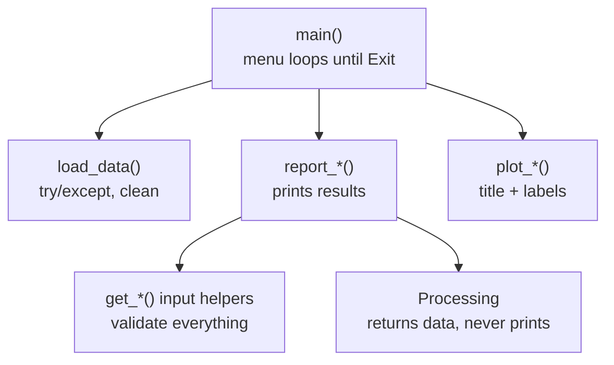

# Task 4a · Coding with pandas

**34 marks:** Functionality 6 · Logic 3 · Robustness 3 · Security 6 · **Organisation 8** · **User experience 8**

Nearly half the marks (16) are for tidy, commented code and friendly output.

## 1. The skeleton



```python
def main():
    """Load the data, then show the menu until the user picks Exit."""
    data = load_data(DATA_FILE)
    if data is None:
        return
    while True:
        choice = get_menu_choice("Main menu", OPTIONS)
        if choice == len(OPTIONS):
            break
        REPORTS[choice](data)


if __name__ == "__main__":
    main()
```

## 2. Six patterns to know by heart

**1 · Load safely**
```python
try:
    df = pd.read_csv(FILE)
except FileNotFoundError:
    print(f"Can't find {FILE}. Put it in the same folder as this program.")
    return None
```

**2 · Dates**
```python
df["Date"] = pd.to_datetime(df["Date"], format="%d/%m/%Y", errors="coerce")
```

**3 · Filter with one mask**
```python
mask = (df["Runner"] == name) & df["Date"].between(start, end)
results = df.loc[mask].copy()
```

**4 · Count, never `None`**
```python
ORDER = ["1st", "2nd", "3rd", "Top 10", "Finished"]
counts = results["Position"].value_counts().reindex(ORDER, fill_value=0)
```

**5 · Compare groups**
```python
pd.crosstab(results["Event"], results["Position"])
results.groupby("Event")["Prize Money"].agg(["count", "sum", "mean"])
```

**6 · Input loop**
```python
def get_menu_choice(title, options):
    """Show a numbered menu; return a valid number from 1 to len(options)."""
    while True:
        print(f"\n{title}")
        for number, option in enumerate(options, start=1):
            print(f"  {number}. {option}")
        answer = input("Choice: ").strip()
        if answer.isdigit() and 1 <= int(answer) <= len(options):
            return int(answer)
        print(f"Please enter a number from 1 to {len(options)}.")
```

## 3. Output that scores user-experience marks

```python
print(f"£{1550.5:,.2f}")        # £1,550.50
print(f"{66.666:.1f}%")         # 66.7%
print(f"  {'Gold':<8}{3:>3}")   # lined-up columns

plt.title("Positions by event")
plt.xlabel("Position")
plt.ylabel("Races")
plt.tight_layout()
plt.show()
```

## 4. Always / never

| ✅ Always | ❌ Never |
|---|---|
| `main()` and `if __name__ == "__main__":` | Code at the top level of the file |
| A docstring on every function | Global variables changed by functions |
| Numbered menus | Making the user type a name exactly |
| Range check before `list[choice - 1]` | `list[0 - 1]`: silently the **last** item |
| `.reindex(..., fill_value=0)` | `.get("Bronze")` → prints `None` |
| `except ValueError:` | Bare `except:` |
| `.copy()` after filtering | Changing the original data |
| A "no results" message | A traceback shown to the user |

Run `practice/patterns.py` to see each pattern work. Compare your code with `reference/Task4a_Model_Solution.py`.
