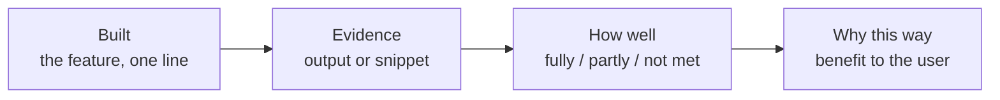

# Task 4b · Reflective evaluation

**9 marks:** Review of outcomes 6 · Future developments 3

The examiner wants **judgements with evidence**, not a tour of your code.

## 1. Every point is a chain

## 2. Judgement scale

| Verdict | Say |
|---|---|
| ✅ Fully met | How you know (test, output) |
| 🟡 Partly met | What's missing, and why |
| ❌ Not met | Why, and how you'd fix it |

"Partly met" with an honest reason scores higher than "works exactly as intended".

## 3. Before and after

| Describing (band 1) | Judging (band 3) |
|---|---|
| "I reused calculate_places() and changed .value_counts() to .sum(). It works exactly as intended." | "Option 3 totals an athlete's prize money for any date range (£1,550.50 for Ana Silva in 2024–25). This fully meets the prize money requirement for one athlete, but only partly meets the manager's need to compare athletes. I let users choose the dates so the tool stays useful as new results are added." |

## 4. Sentence starters

- "To meet the requirement for …, I built …"
- "As the output shows, …"
- "This fully / partly meets the need because …"
- "I chose this approach so that coaches can …"
- "In testing, …"

## 5. Future developments: extensions, not fixes

| ❌ Fix (low marks) | ✅ Extension + benefit (top marks) |
|---|---|
| Add try/except | Average prize money per event, **so managers can see which events are worth entering** |
| Make lower-case input work | Compare an athlete with the squad average, **so coaches can spot who needs support** |
| Get the date filter on the graph working | Export a monthly report, **so management meetings have the figures ready** |

## 6. Page plan

1. One chain per **system** requirement
2. One chain per **user** requirement
3. Accuracy: rounding, date parsing, data cleaning
4. Three extensions, each with who benefits
5. An overall judgement
