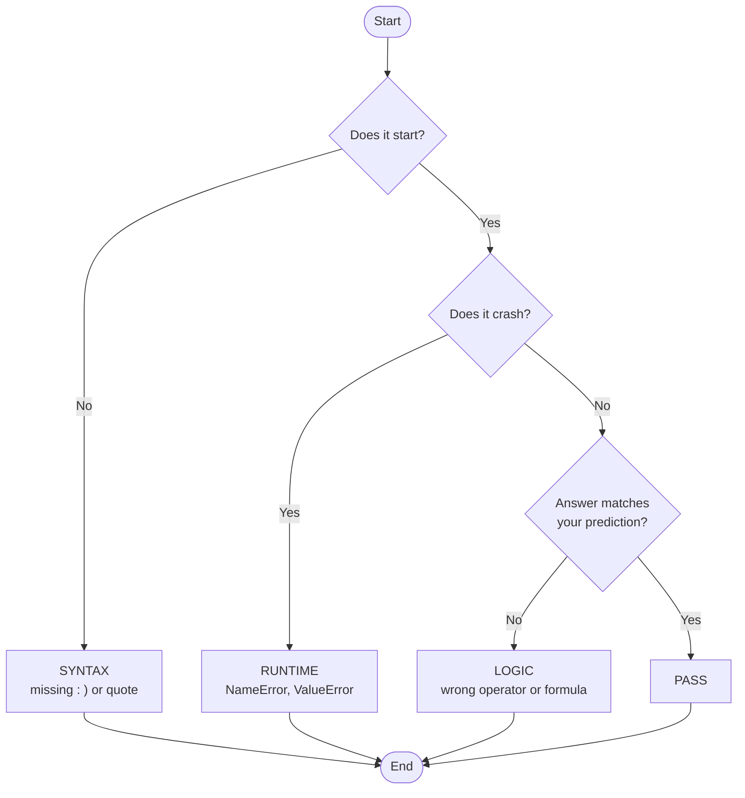

# Task 2 · Testing and Fixing Code

**21 marks** · Testing 9 · Understanding 3 · Fix 9

> **The big idea:** top marks come from *good tests*, not from finding lots of bugs.

### How to use this sheet

For each input in your program:

1. Choose a normal value.
2. Test just below, on and just above every limit.
3. Try an invalid value.
4. Write what you expect **before** running the program.
5. Compare the result, record any fault, fix it and test again.

---

## 1. Test three kinds of data

| Type | Meaning | Example (valid: 45 to 150) |
|------|---------|----------------------------|
| **Normal** | Typical valid value | `90` |
| **Boundary** | One below, on, one above each limit | `44` `45` `46` · `149` `150` `151` |
| **Erroneous** | Wrong or impossible | `"abc"` · blank · `-5` |

| Value | 44 | 45 | 46 | 90 | 149 | 150 | 151 |
|:-----:|:--:|:--:|:--:|:--:|:---:|:---:|:---:|
| Result | ❌ | ✅ | ✅ | ✅ | ✅ | ✅ | ❌ |

Use an ordinary value such as `90` as well as boundary values. Erroneous data could include `"abc"`, blank input, `-5` or `1.5`.

---

## 2. Name the error

Use these simple questions in order: **Does the program start? Does it crash? Is the answer correct?**

| Error | What it means | Example |
|-------|---------------|---------|
| Syntax | Python cannot understand the code | Missing `:` or closing `)` |
| Runtime | The program starts but crashes while running | Converting `"abc"` to a number |
| Logic | The program runs but gives the wrong answer | Using `>` instead of `>=` |

---

## 3. Follow the loop every time

**Predict → Run → Compare → Record → Fix → Retest**

- Write the expected result **before** running.
- Never write "works as intended" if it is wrong.
- Never record a fix without a **retest**.

---

## 4. Test log (one row per test)

| Test | Data (type) | Expected | Actual | Line + error type | Fix + retest |
|------|-------------|----------|--------|-------------------|--------------|
| Upper limit | `150` (boundary) | Accepted | "Not valid" | Line 40, logic | Changed `>= 150` to `> 150`. Retested 149, 150, 151 ✅ |

---

## 5. Work out answers by hand

80 kg → 76 kg in 2 weeks, max loss 1% per week:

| Step | Working | Answer |
|------|---------|--------|
| Lose in total | 80 − 76 | 4.0 kg |
| Per week | 4 ÷ 2 | 2.0 kg |
| Maximum per week | 80 × 0.01 | 0.8 kg |
| Allowed? | 2.0 > 0.8 | **No** |

---

## Sentences to reuse

- "The boundary test used one value below, on, and one value above the limit."
- "The actual result did not match my prediction, so this was a logic error."
- "I changed `[code]` on line `[number]`, then retested `[values]`."

---

## Final check

- [ ] Normal, boundary **and** erroneous data
- [ ] Expected result written first
- [ ] Error type + line number for every fault
- [ ] Every fix has a retest
- [ ] No debug prints, no tracebacks
